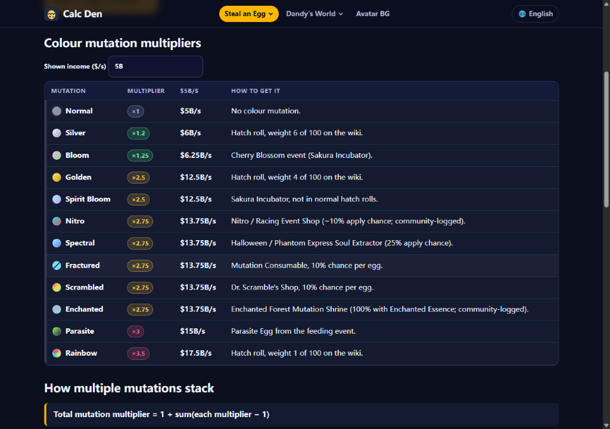
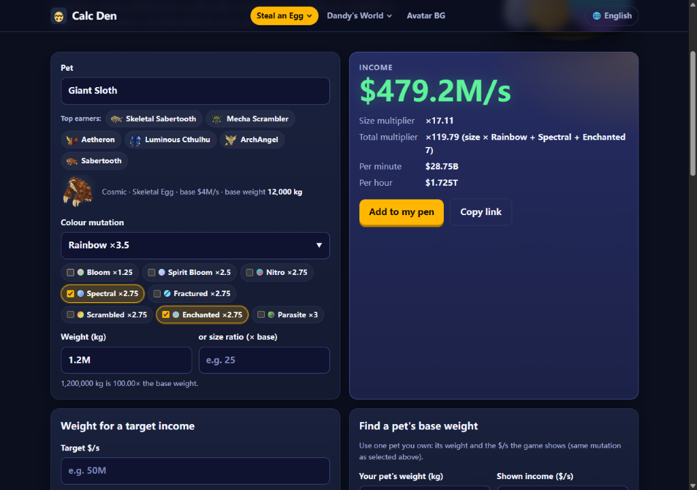

# Steal an Egg Formulas (Income, Weight Soft Cap, Stacked Mutations & Speed)

Reference formulas and a zero-dependency JavaScript module for the Roblox game **Steal an Egg**, matching the wiki math (`Module:Pets/Data`, `Module:IncomeCalculator/Data`, `Mutations`, and biome speed requirements).

If you just want to run numbers in your browser without code, use the [interactive Steal an Egg income calculator on Calc Den](https://calcdenhq.com/steal-an-egg-calculator/).

---

## 1. Pet Income & Weight Scaling (125× Soft Cap)

A pet's income per second (`$/s`) depends on its **base income**, its **weight ratio** (`pet weight / base weight`), and its **total mutation multiplier**:

```text
ratio = pet_weight / base_weight

if ratio <= 125:
    size_multiplier = ratio ^ (37 / 60)
else:
    size_multiplier = ratio ^ (2 / 5) * 125 ^ (13 / 60)

income_per_second = base_income * size_multiplier * mutation_multiplier
```

Why the piecewise formula? Past **125× base weight**, weight scaling softens from exponent `37/60` (~0.6167) down to `2/5` (`0.40`), while staying continuous right at `125×` (`size_multiplier ≈ 19.64×`).

| Weight vs Base | Size Multiplier | Notes |
|---:|---:|---|
| 1× | ×1.00 | Base weight |
| 2× | ×1.53 | Small upgrade |
| 10× | ×4.14 | |
| 100× | ×17.11 | |
| 125× | ×19.64 | Soft-cap bend |
| 200× | ×23.70 | Diminishing returns |
| 1,000× | ×45.12 | |

For pets that do not have a wiki-listed base weight yet (74 newer pets out of 265), you can invert `size_multiplier` from one pet you own (`weight` + displayed `$/s`) to recover its hidden base weight—see `baseWeightFrom()` in [`formulas.mjs`](./formulas.mjs) or browse the [265-pet base income & weight list](https://calcdenhq.com/steal-an-egg/pets/).

---

## 2. Mutation Stacking Formula

Multiple mutations do **not** multiply against each other. Only the bonus above `1×` stacks additively:

```text
total_mutation_multiplier = 1 + sum(multiplier_i - 1)
```

- **Hatch variants (pick at most 1)**: Silver (`×1.2`), Golden (`×2.5`), Rainbow (`×3.5`).
- **Event & shrine traits (stackable)**: Bloom (`×1.25`), Spirit Bloom (`×2.5`), Nitro (`×2.75`), Spectral (`×2.75`), Fractured (`×2.75`), Scrambled (`×2.75`), Enchanted (`×2.75`), Parasite (`×3.0`).

**Worked examples:**
- `Rainbow (×3.5) + Enchanted (×2.75) + Spectral (×2.75)` → `1 + 2.5 + 1.75 + 1.75 = ×7.00`
- `Nitro + Scrambled + Enchanted + Spectral (4 × 2.75)` → `1 + 1.75 × 4 = ×8.00`

See the [full mutation multiplier table](https://calcdenhq.com/steal-an-egg/mutations/) for apply chances and source events.



---

## 3. Speed & Biome Unlock Formula

Speed gained per treadmill step multiplies treadmill base gain, equipped trail multiplier, and active Robux speed boost tier:

```text
speed_per_step = treadmill_per_step * trail_multiplier * boost_multiplier
steps_needed   = ceil(max(0, target_speed - current_speed) / speed_per_step)
```

**Examples:**
- `Angelic Treadmill (+2,000)` × `Divine Trail (×14)` × `No boost (×1)` = **28,000 / step**
- `Guardian Treadmill (+8,500)` × `Moonbloom Trail (×20)` × `x4K (×4,096)` = **696,320,000 / step**

| Biome | Speed Needed | Guardian |
|---|---:|---|
| Forest | 0 | Chicken |
| Lake | 900 | Swan |
| Desert | 10K | Scorpion |
| Jungle | 40K | Tiger |
| Snow | 170K | Yeti |
| Volcano | 700K | Cerberus |
| Abyss Ocean | 2.5M | Moby |
| Prehistoric | 18M | T-Rex |
| Cosmic | 700M | Cosmic Skeleton |
| Cherry Blossom | 2.5B | Oni Tiger |
| Titan Temple | 7B | Gorilla King |
| Angels & Demons | 20B | ArchAngel, World Burner, Aetheron |

To compare how many steps the next treadmill or trail saves, try the [biome speed & step calculator](https://calcdenhq.com/steal-an-egg/speed-calculator/) or check [all eggs by biome](https://calcdenhq.com/steal-an-egg/eggs/).

---

## Quick Usage (Node.js)

```js
import { sizeMultiplier, stackedMutation, income, perStep, stepsTo } from './formulas.mjs';

const mut = stackedMutation([3.5, 2.75, 2.75]); // 7.0 (Rainbow + Enchanted + Spectral)
const res = income({ base: 4_000_000, weight: 1_200_000, baseWeight: 12_000, mutation: mut });
console.log(res); // { ratio: 100, size: 17.11..., total: 119.79..., perSecond: 479173174... }

const step = perStep(2000, 14, 1); // 28000 speed/step
console.log(stepsTo(0, 700_000, step)); // 25 steps to Volcano
```

Run the built-in self-check:

```bash
node formulas.mjs
```



## License & Attribution

- Code in this repository: MIT License.
- Game data and formula notes originally documented by the [Steal an Egg Wiki (Fandom)](https://stealanegg.fandom.com/wiki/Pets) under CC BY-SA 3.0.
